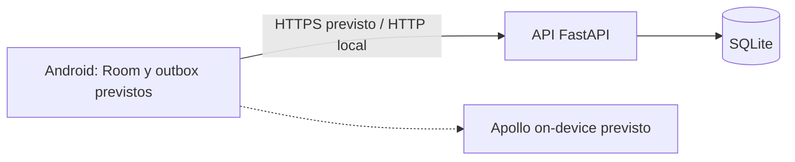
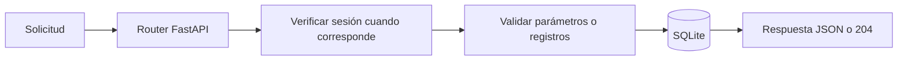

# 02 — Arquitectura

El backend es un proceso FastAPI que comparte una conexión SQLite durante su ciclo de vida. Al arrancar abre la base y aplica migraciones; al terminar cierra la conexión. Cada router verifica explícitamente el Bearer cuando corresponde. Los endpoints son asíncronos, pero usan SQLite síncrono; no existe una capa de servicios o repositorios separada de los módulos funcionales.

Este diagrama distingue los componentes presentes en este repositorio de las responsabilidades y planes externos, cuya implementación no se verificó.

El diagrama siguiente muestra dependencias del código existente y su conexión común.

El flujo de datos depende de la operación: sync escribe; perfil, bootstrap, historiales y alertas leen. Health es público.

`src/eir`: `main.py` construye app y health; `config.py` lee la ruta; `database.py` define cinco migraciones; `auth.py` gestiona cuentas/sesiones; `profiles.py` perfil/bootstrap; `health_records.py` y `wellbeing.py` validan, guardan y consultan; `sync.py` procesa lotes; `alerts.py` lee alertas. `contracts/` contiene baseline y lock; `tests/` pruebas; `orchestration/` automatización de gobernanza, fuera del runtime API; `docs/` decisiones; Dockerfile y Compose preparan ejecución. No hay directorio de migraciones externo: están en Python.

Decisiones y consecuencias: SQLite simplifica despliegue y persistencia local, pero el diseño actual no es multihost; UUID inmutable permite reintentos, pero un conflicto requiere resolución externa; paginación por ID no ofrece snapshot; firma por sesión permite revocación, pero requiere proteger la base. El plan de un solo proceso no es prueba de seguridad bajo concurrencia. Fuentes: [main](../../src/eir/main.py), [migraciones](../../src/eir/database.py), [decisiones](../DECISIONS.md).
