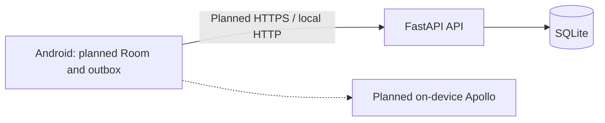
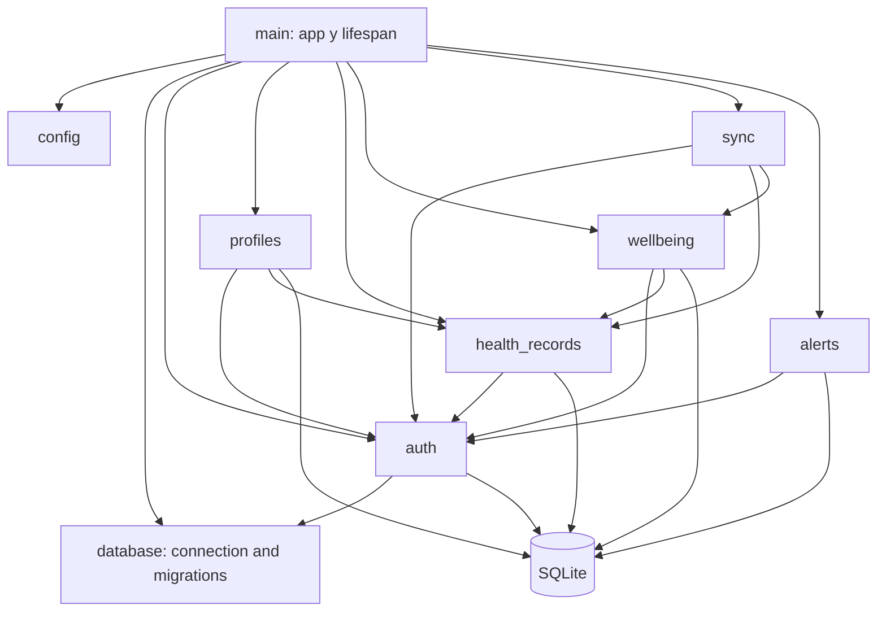

# 02 — Architecture

The backend is a FastAPI process that shares a SQLite connection throughout its lifecycle. It opens the database and applies migrations at startup, then closes the connection at shutdown. Each router explicitly verifies Bearer authentication where required. Endpoints are asynchronous but use synchronous SQLite; there is no service or repository layer separate from the functional modules.

This diagram distinguishes components present in this repository from external responsibilities and plans whose implementation has not been verified.

The following diagram shows dependencies in the existing code and their shared connection.

Data flows depend on the operation: sync writes; profile, bootstrap, history, and alerts read. Health is public.

`src/eir`: `main.py` builds the app and health endpoint; `config.py` reads the database path; `database.py` defines five migrations; `auth.py` manages accounts and sessions; `profiles.py` handles profiles and bootstrap; `health_records.py` and `wellbeing.py` validate, store, and query records; `sync.py` processes batches; `alerts.py` reads alerts. `contracts/` contains the baseline and lock; `tests/` contains tests; `orchestration/` contains governance automation outside the API runtime; `docs/` contains decisions; the Dockerfile and Compose prepare execution. There is no external migrations directory; migrations are in Python.

Decisions and consequences: SQLite simplifies deployment and local persistence, but the current design is not multi-host; immutable UUIDs allow retries, but conflicts require external resolution; ID-based pagination does not provide a snapshot; per-session signing allows revocation but requires database protection. The single-process plan is not proof of concurrency safety. Sources: [main](../../src/eir/main.py), [migrations](../../src/eir/database.py), [decisions](../DECISIONS.md).
