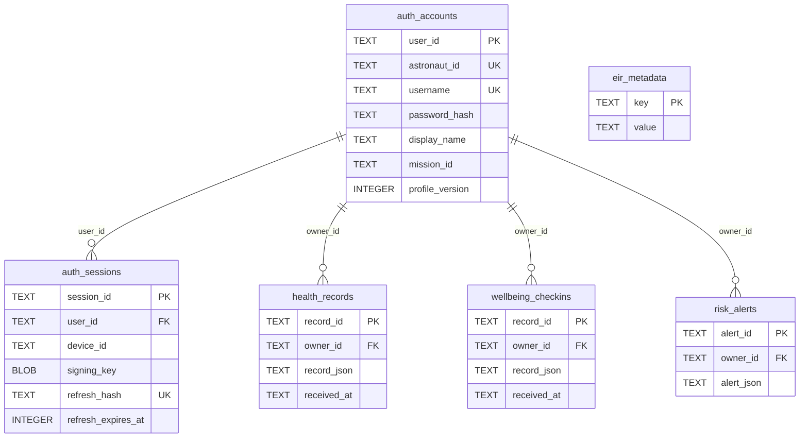

# 03 — Base de datos

El esquema siguiente proviene exclusivamente de las migraciones en [database.py](../../src/eir/database.py), no de una base de producción. `TEXT PRIMARY KEY` se declara tal cual: SQLite permite matices de nulidad para primary keys no INTEGER en tablas ordinarias; no se debe inferir `NOT NULL` adicional si no aparece en SQL.

| Tabla | Columnas y restricciones declaradas |
|---|---|
| `eir_metadata` | `key TEXT PRIMARY KEY`; `value TEXT NOT NULL` |
| `auth_accounts` | `user_id TEXT PRIMARY KEY`; `astronaut_id TEXT NOT NULL UNIQUE`; `username TEXT NOT NULL UNIQUE`; `password_hash TEXT NOT NULL`; `display_name TEXT NOT NULL`; `mission_id TEXT NOT NULL`; `profile_version INTEGER NOT NULL CHECK (profile_version >= 1)` |
| `auth_sessions` | `session_id TEXT PRIMARY KEY`; `user_id TEXT NOT NULL REFERENCES auth_accounts(user_id)`; `device_id TEXT NOT NULL`; `signing_key BLOB`; `refresh_hash TEXT UNIQUE`; `refresh_expires_at INTEGER` |
| `health_records` | `record_id TEXT PRIMARY KEY`; `owner_id TEXT NOT NULL REFERENCES auth_accounts(user_id)`; `record_json TEXT NOT NULL`; `received_at TEXT NOT NULL` |
| `wellbeing_checkins` | mismas columnas y restricciones que `health_records` |
| `risk_alerts` | `alert_id TEXT PRIMARY KEY`; `owner_id TEXT NOT NULL REFERENCES auth_accounts(user_id)`; `alert_json TEXT NOT NULL` |

Índices explícitos: `health_records_owner_id (owner_id, record_id)`, `wellbeing_checkins_owner_id (owner_id, record_id)` y `risk_alerts_owner_id (owner_id, alert_id)`. Las restricciones PRIMARY KEY y UNIQUE también crean índices automáticos según SQLite. No se declara cascada de borrado. No existen tablas de misión, reglas, outbox o deduplicación separada: el registro es su propio marcador de deduplicación.

El diagrama representa solo claves foráneas reales; los datos de alertas y registros están en JSON, no en relaciones relacionales individuales.

`EIR_DATABASE_PATH` selecciona archivo (por defecto `eir.sqlite3`; Compose usa `/data/eir.sqlite3`). `PRAGMA foreign_keys=ON` se configura por conexión. Cinco migraciones ordenadas se aplican en una transacción `BEGIN EXCLUSIVE`, con versión en `PRAGMA user_version`; cualquier fallo revierte todo y una versión futura impide el inicio. Cada registro sync se inserta en su propia transacción `BEGIN IMMEDIATE`, con rollback en fallo; el lote completo no es atómico. El acceso a registros se filtra por el `user_id` de la sesión verificada, no por campos enviados. La unicidad entre ambas tablas de registros se comprueba en código dentro de esa transacción, no mediante una restricción global SQL. SQLite no cifra la base; archivo y respaldos necesitan protección.
