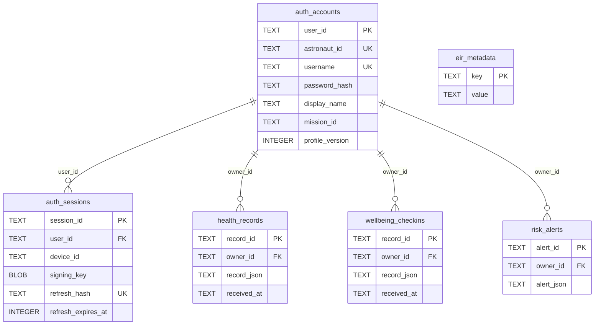

# 03 — Database

The schema below comes only from the migrations in [database.py](../../src/eir/database.py), not from a production database. `TEXT PRIMARY KEY` is declared as written: SQLite allows nuances around nullability for non-INTEGER primary keys in ordinary tables; do not infer additional `NOT NULL` constraints unless they appear in the SQL.

| Table | Declared columns and constraints |
|---|---|
| `eir_metadata` | `key TEXT PRIMARY KEY`; `value TEXT NOT NULL` |
| `auth_accounts` | `user_id TEXT PRIMARY KEY`; `astronaut_id TEXT NOT NULL UNIQUE`; `username TEXT NOT NULL UNIQUE`; `password_hash TEXT NOT NULL`; `display_name TEXT NOT NULL`; `mission_id TEXT NOT NULL`; `profile_version INTEGER NOT NULL CHECK (profile_version >= 1)` |
| `auth_sessions` | `session_id TEXT PRIMARY KEY`; `user_id TEXT NOT NULL REFERENCES auth_accounts(user_id)`; `device_id TEXT NOT NULL`; `signing_key BLOB`; `refresh_hash TEXT UNIQUE`; `refresh_expires_at INTEGER` |
| `health_records` | `record_id TEXT PRIMARY KEY`; `owner_id TEXT NOT NULL REFERENCES auth_accounts(user_id)`; `record_json TEXT NOT NULL`; `received_at TEXT NOT NULL` |
| `wellbeing_checkins` | Same columns and constraints as `health_records` |
| `risk_alerts` | `alert_id TEXT PRIMARY KEY`; `owner_id TEXT NOT NULL REFERENCES auth_accounts(user_id)`; `alert_json TEXT NOT NULL` |

Explicit indexes: `health_records_owner_id (owner_id, record_id)`, `wellbeing_checkins_owner_id (owner_id, record_id)`, and `risk_alerts_owner_id (owner_id, alert_id)`. PRIMARY KEY and UNIQUE constraints also create automatic indexes in SQLite. No delete cascade is declared. There are no mission, rules, outbox, or separate deduplication tables: the record itself serves as the deduplication marker.

The diagram shows only actual foreign keys; alert and record data are stored as JSON, not as individual relational fields.

`EIR_DATABASE_PATH` selects the file (default `eir.sqlite3`; Compose uses `/data/eir.sqlite3`). `PRAGMA foreign_keys=ON` is set per connection. Five ordered migrations are applied in a `BEGIN EXCLUSIVE` transaction, with the version stored in `PRAGMA user_version`; any failure rolls back the transaction, and a future schema version prevents startup. Each sync record is inserted in its own `BEGIN IMMEDIATE` transaction and rolled back on failure; the entire batch is not atomic. Record access is filtered by the verified session's `user_id`, not by supplied fields. Uniqueness across both record tables is checked in code within that transaction, not by a global SQL constraint. SQLite does not encrypt the database; the file and backups need protection.
