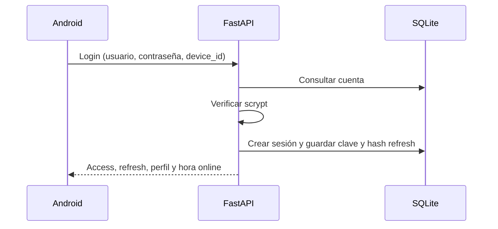
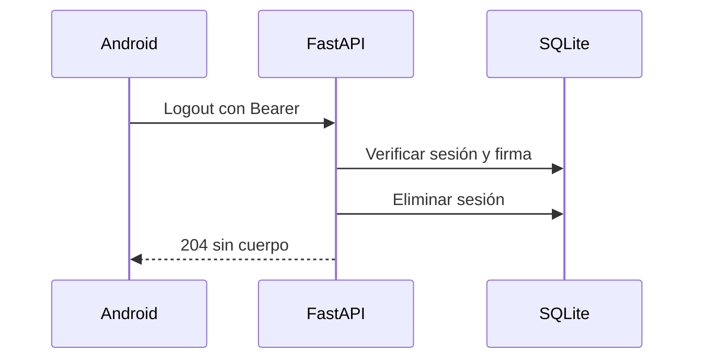

# 05 — Autenticación y seguridad

Las cuentas sintéticas se crean localmente con `python -m eir.auth USERNAME DISPLAY_NAME MISSION_ID`, que solicita contraseña dos veces sin eco. No hay registro público ni credenciales por defecto. Se almacena scrypt con salt aleatorio de 16 bytes y parámetros n=16384, r=8, p=1; la comparación usa `hmac.compare_digest`. Para usuario inexistente se ejecuta también scrypt con hash ficticio. Fuentes: [auth.py](../../src/eir/auth.py), [database.py](../../src/eir/database.py).

La secuencia muestra la sesión por dispositivo que se crea tras verificar credenciales.



El access token JWT HS256 contiene `sid` y `exp`, expira en 900 segundos y se firma con clave aleatoria propia de la sesión, guardada en SQLite. En cada solicitud se valida firma, expiración y existencia de sesión; el propietario proviene del `user_id` almacenado. El refresh opaco tiene 30 días, se guarda solo su SHA-256 y se vincula al `device_id`. Su rotación reemplaza hash y clave de firma en transacción: invalida ambos tokens anteriores y reinicia la expiración del refresh. No renueva `online_authenticated_at` ni la ventana offline.

Esta secuencia muestra rotación; un refresh antiguo o de otro dispositivo recibe 401.

```mermaid
sequenceDiagram
  participant A as Android
  participant API as FastAPI
  participant DB as SQLite
  A->>API: Refresh y device_id
  API->>DB: BEGIN IMMEDIATE; buscar hash, dispositivo y expiración
  DB-->>API: Sesión válida
  API->>DB: Rotar clave, hash y vencimiento; COMMIT
  API-->>A: Nuevos access y refresh
```

La revocación elimina únicamente la sesión autenticada; repetir logout con token revocado devuelve 401.



Los endpoints privados filtran por cuenta verificada. Varias sesiones de la misma cuenta pueden coexistir; logout no revoca las demás. El aislamiento está probado para casos concretos, no auditado formalmente. No hay rate limiting, bloqueo frente a fuerza bruta, inventario/revocación administrativa de sesiones, cifrado de SQLite ni gestión externa de claves en el código. Las claves de firma y hashes sensibles están en la base: restringir acceso y proteger backups. TLS, secretos en logs de infraestructura, políticas de retención y auditoría requieren verificación de despliegue; no se ha probado un entorno productivo. La validación del token es propia del proyecto y requiere revisión independiente.

La limpieza de caché, protección de pendientes y desbloqueo offline de 24 horas son decisiones Android, no endpoints backend. El diseño criptográfico offline sigue abierto. Nunca usar datos reales ni incluir secretos en ejemplos o logs.
