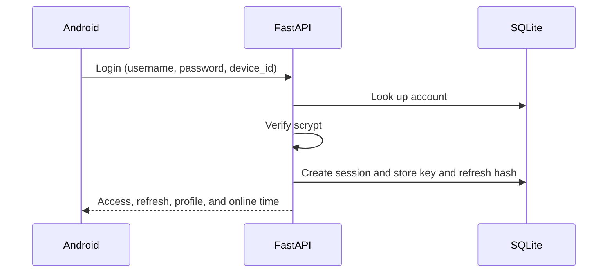
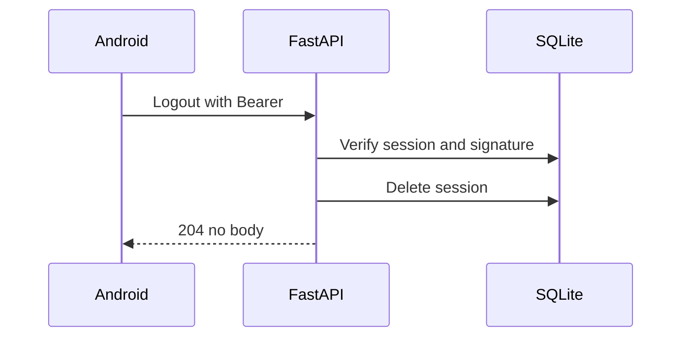

# 05 — Authentication and Security

Synthetic accounts are created locally with `python -m eir.auth USERNAME DISPLAY_NAME MISSION_ID`, which prompts for the password twice without echoing it. There is no public registration or default credential. Passwords are stored using scrypt with a random 16-byte salt and parameters n=16384, r=8, p=1; comparison uses `hmac.compare_digest`. For a nonexistent user, scrypt is also run with a dummy hash. Sources: [auth.py](../../src/eir/auth.py), [database.py](../../src/eir/database.py).

The sequence shows the per-device session created after credentials are verified.



The HS256 JWT access token contains `sid` and `exp`, expires after 900 seconds, and is signed with a random per-session key stored in SQLite. Each request validates the signature, expiration, and session existence; the owner comes from the stored `user_id`. The opaque refresh token lasts 30 days, only its SHA-256 is stored, and it is bound to the `device_id`. Rotation replaces the hash and signing key in a transaction, invalidating both previous tokens and resetting the refresh expiration. It does not renew `online_authenticated_at` or the offline window.

This sequence shows token rotation; an old refresh token or one from another device receives 401.

```mermaid
sequenceDiagram
  participant A as Android
  participant API as FastAPI
  participant DB as SQLite
  A->>API: Refresh and device_id
  API->>DB: BEGIN IMMEDIATE; find hash, device, and expiry
  DB-->>API: Valid session
  API->>DB: Rotate key, hash, and expiry; COMMIT
  API-->>A: New access and refresh tokens
```

Revocation removes only the authenticated session; repeating logout with a revoked token returns 401.



Private endpoints filter by verified account. Multiple sessions for the same account can coexist; logout does not revoke the others. Isolation has been tested for specific cases, not formally audited. The code has no rate limiting, brute-force lockout, administrative session inventory/revocation, SQLite encryption, or external key management. Signing keys and sensitive hashes are in the database: restrict access and protect backups. TLS, secrets in infrastructure logs, retention policies, and auditing require deployment verification; no production environment has been tested. Token validation is project-specific and needs independent review.

Cache cleanup, protection of pending data, and 24-hour offline unlock are Android decisions, not backend endpoints. Offline cryptographic design remains open. Never use real data or include secrets in examples or logs.
