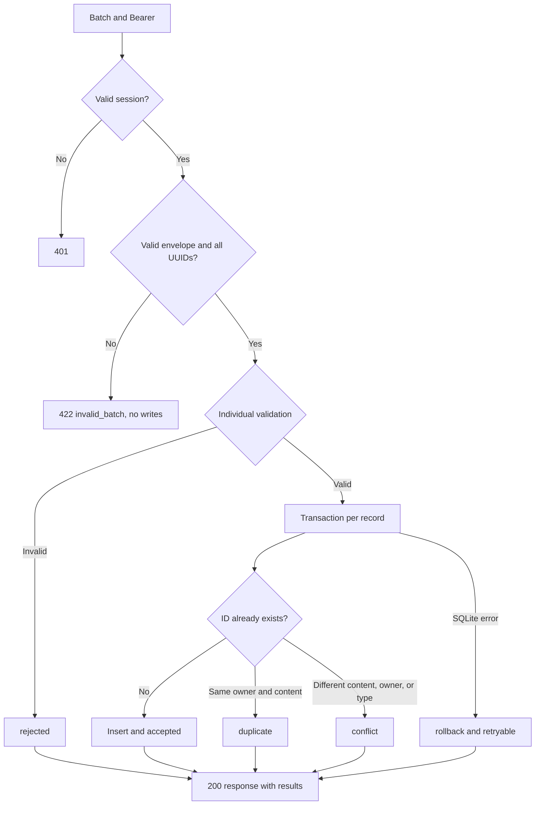

# 06 — Synchronization

Level 2 means uploading records to the server, not continuous bidirectional synchronization. Android must maintain Room and a durable outbox, stable UUIDs, account ownership, retries, and local protection; this repository does not verify that Android does so. Bootstrap and history endpoints allow data downloads, but do not constitute an incremental bidirectional protocol. The contract and payloads are described in [API](04-api.md).

The sequence illustrates an upload and retry after a lost response.

```mermaid
sequenceDiagram
  participant A as Android (planned)
  participant API as Sync FastAPI
  participant DB as SQLite
  A->>API: Bearer batch with stable UUID
  API->>API: Validate session, envelope, and all UUIDs
  loop Each valid record
    API->>DB: BEGIN IMMEDIATE; check ID and insert; COMMIT
    DB-->>API: accepted, duplicate o conflict
  end
  API-->>A: HTTP 200 with per-record results
  Note over A: Keep pending if the response is lost
  A->>API: Retry same record and UUID
  API-->>A: duplicate if identical record was already stored
```

This flow shows the implemented paths; an invalid batch is not partially processed.



IDs are normalized as UUIDs; content is serialized with sorted keys and a UTC timestamp. Equality is checked against normalized JSON and the owner; arbitrary equivalence of numeric representations or omitted fields is not promised. The primary key stores the marker and record in the same operation. Collisions across the two tables are checked. Valid items are committed independently: a failure does not roll back other items already committed. Recoverable SQLite errors return `storage_unavailable` and `retryable: true`; item validation returns `invalid_record`. A timeout or ambiguous response does not confirm anything: the client must retain and resend the same ID; conflicts require resolution, not an automatically generated new ID. Batches may contain only 1–20 items.

The server verifies Bearer authentication and derives ownership from the session; the received `device_id` is structurally validated but not compared with the session's device. Android response handling and queue decisions have not been tested here. There is no binary upload or automatic conflict resolution. Sources: [sync.py](../../src/eir/sync.py), [health_records.py](../../src/eir/health_records.py), [wellbeing.py](../../src/eir/wellbeing.py), [decisions](../DECISIONS.md).
