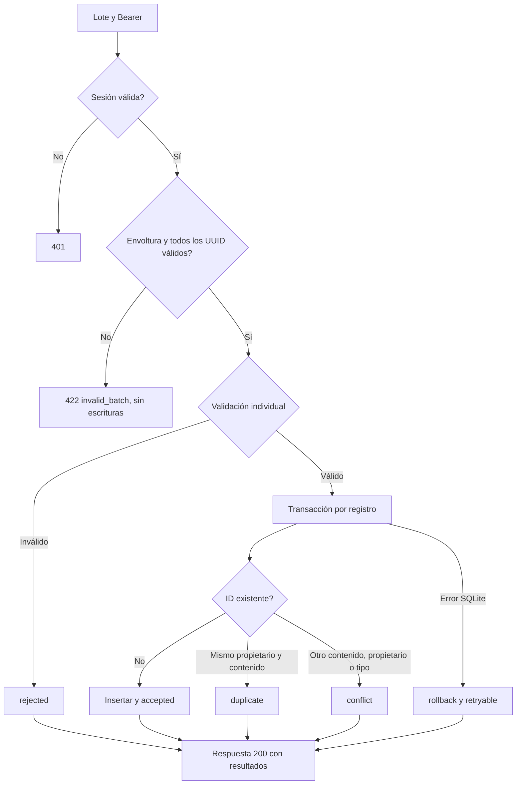

# 06 — Sincronización

Level 2 es carga de registros hacia el servidor, no sincronización bidireccional continua. Android debe mantener Room y outbox durable, UUID estables, propiedad por cuenta, reintentos y protección local; este repositorio no verifica que Android lo haga. Bootstrap e historiales permiten descargar datos, pero no constituyen un protocolo incremental bidireccional. Contrato y payloads están en [API](04-api.md).

La secuencia ilustra un envío y un reintento tras una respuesta perdida.

```mermaid
sequenceDiagram
  participant A as Android (previsto)
  participant API as Sync FastAPI
  participant DB as SQLite
  A->>API: Lote Bearer con UUID estable
  API->>API: Validar sesión, envoltura y todos los UUID
  loop Cada registro válido
    API->>DB: BEGIN IMMEDIATE; comprobar ID e insertar; COMMIT
    DB-->>API: accepted, duplicate o conflict
  end
  API-->>A: HTTP 200 con resultado por registro
  Note over A: Si se pierde la respuesta, conservar pendiente
  A->>API: Reenviar mismo registro y UUID
  API-->>A: duplicate si ya se guardó idéntico
```

Este flujo muestra los caminos implementados; un lote inválido no se procesa parcialmente.



Los IDs se normalizan como UUID; el contenido se serializa con claves ordenadas y fecha en UTC. La igualdad se compara con el JSON normalizado y el propietario; no promete equivalencia arbitraria de representaciones numéricas o campos omitidos. La clave primaria guarda el marcador y el registro en la misma operación. Se comprueban colisiones entre las dos tablas. Los elementos válidos se confirman independientemente: un fallo no revierte otros ya confirmados. Errores recuperables de SQLite devuelven `storage_unavailable` y `retryable: true`; validación de elemento devuelve `invalid_record`. Un timeout o respuesta ambigua no confirma nada: el cliente debe conservar y reenviar el mismo ID; conflictos requieren resolución, no un nuevo ID automático. Solo se aceptan 1–20 elementos por lote.

El servidor verifica Bearer y deriva propiedad de sesión; el `device_id` recibido se valida estructuralmente pero no se compara con el dispositivo de la sesión. Las respuestas y decisiones de cola en Android no se han probado aquí. No hay carga de binarios ni resolución automática de conflictos. Fuentes: [sync.py](../../src/eir/sync.py), [health_records.py](../../src/eir/health_records.py), [wellbeing.py](../../src/eir/wellbeing.py), [decisiones](../DECISIONS.md).
